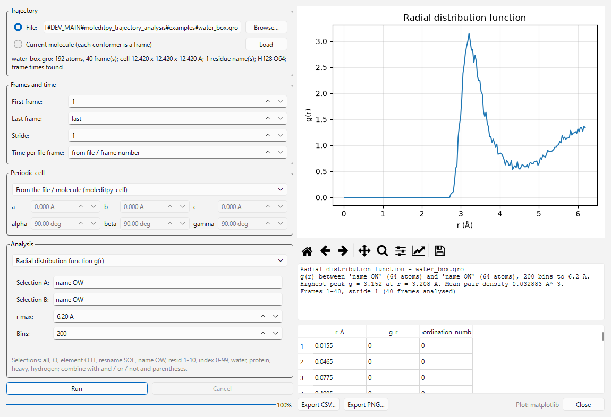
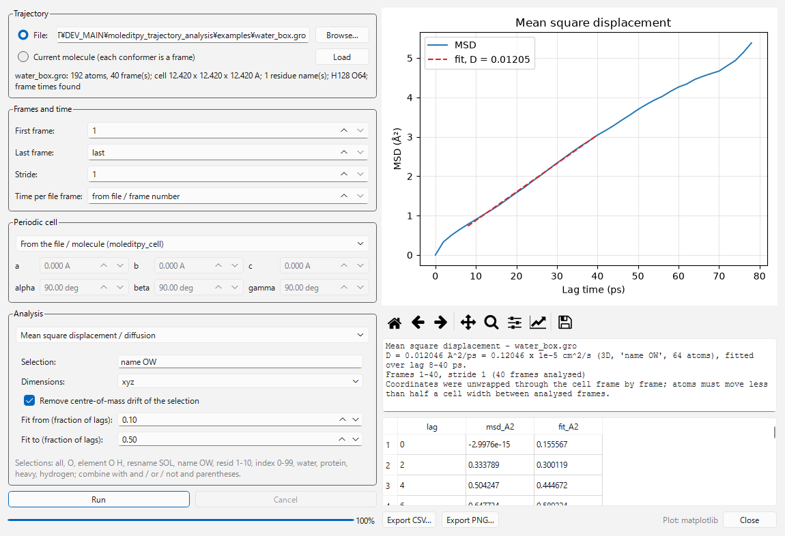
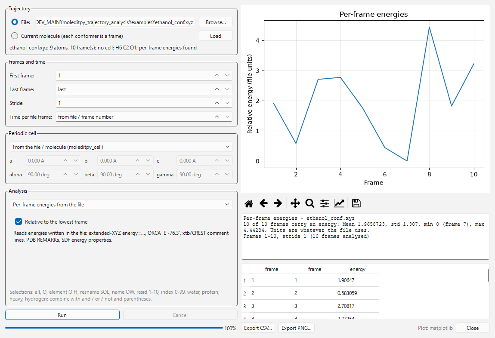

# Trajectory Analysis for MoleditPy

A [MoleditPy](https://github.com/HiroYokoyama/python_molecular_editor) plugin that analyses
molecular dynamics trajectories and conformer ensembles:

- **Radial distribution function g(r)** between two atom selections, with the
  minimum-image convention when a periodic cell is known, plus the running
  coordination number n(r).
- **Mean square displacement** (FFT algorithm, all time origins) and the **diffusion
  coefficient** from a linear fit over a chosen lag window, in 3D or for chosen axes.
- **RMSD** against any reference frame and **RMSF** per atom, with optional Kabsch
  alignment on a separate fit selection.
- **Radius of gyration**, mass-weighted or geometric.
- **Density profiles** (mass or number density) along a cell axis.
- **Per-frame energies** found in the file (extended XYZ `energy=`, ORCA `E -76.3`,
  xtb/CREST comment lines, PDB REMARKs, SDF energy properties).

Results are plotted with matplotlib when it is installed, otherwise with a built-in
plot, and can be exported as CSV and PNG.



## Installation

Install it from MoleditPy's Plugin Installer, or download the release ZIP and extract the
`trajectory_analysis` folder into `~/.moleditpy/plugins/Analysis/`. It needs nothing beyond
what MoleditPy already installs (numpy, RDKit, PySide6). matplotlib is optional.

## Usage

Open **Analysis > Trajectory Analysis...**.

1. **Trajectory**: choose a file and press *Load*, or pick *Current molecule* to analyse the
   conformers of the molecule in the editor (each conformer is one frame).
2. **Frames and time**: first and last frame (1-based), stride, and the time between two
   frames of the file in ps. With 0 the plugin uses times written in the file (GROMACS
   `t=` titles) or frame numbers.
3. **Periodic cell**: by default the cell comes from the file (PDB `CRYST1`, GRO box line,
   extended-XYZ `Lattice=`) or, for the current molecule, from its `moleditpy_cell`
   property (set by the MD System Builder). A custom cell can be entered, or periodicity
   switched off.
4. **Analysis**: choose an analysis, fill in its selections, press *Run* (Ctrl+Enter).
   Long runs show progress and can be cancelled.



### Supported files

| Format | Frames | Cell | Extra |
|---|---|---|---|
| PDB / ENT | `MODEL` records (or `END`-separated blocks) | `CRYST1` | residues, REMARK energies |
| GRO | concatenated frames | box line, triclinic included | residues, `t=` times |
| XYZ | concatenated frames | extended-XYZ `Lattice="..."` | comment-line energies |
| SDF | records of the same molecule | none | energy properties |

PDB, GRO and XYZ files are memory-mapped and indexed by frame, so a frame is read only when
it is analysed and files larger than memory work. SDF files are read with RDKit.

### Selections

| Text | Selects |
|---|---|
| `all`, `none` | everything, nothing |
| `O`, `element O H` | elements |
| `resname SOL WAT` | residue names |
| `name OW` | atom names |
| `resid 1-10 15` | residue numbers |
| `index 0-99` | 0-based atom indices |
| `water`, `protein`, `heavy`, `hydrogen` | common groups |

Combine with `and`, `or`, `not` and parentheses, e.g. `resname SOL and not hydrogen`.

### Notes on the methods

- **RDF**: g(r) is normalised by the pair density of each frame, so it tends to 1 for an
  uncorrelated system. With a cell, r max must stay below half the smallest cell width
  (the minimum-image limit). Without a cell, distances are not periodic and the bounding
  box of each frame is used as the volume, so g(r) is only qualitative.
- **MSD**: coordinates are unwrapped frame by frame through the cell, so atoms must move less
  than half a cell width between analysed frames (keep the stride small). The diffusion
  coefficient is slope / (2 d) for d dimensions, reported in Ų/ps and 10⁻⁵ cm²/s.
  Centre-of-mass drift of the selection is removed by default.
- **RMSD / RMSF / Rg**: *Follow atoms through the cell* unwraps the trajectory from the first
  analysed frame, which assumes the molecules are whole in that frame. RMSF is computed
  around the mean aligned position.
- **Density**: with a cell the profile is along the normal of the chosen cell axis, in g/cm³
  or atoms/ų. Without a cell it is a linear density per Å.
- **Energies** are reported in whatever units the file uses.



## Examples

`examples/` holds two small files to try the analyses:

- `water_box.gro`: 64 rigid waters in a 12.42 Å cubic box at 1 g/cm³, 40 frames 2 ps apart.
  The oxygens follow a Lennard-Jones Monte Carlo run, so this is a liquid-like
  pseudo-trajectory for trying the analyses, not real MD.
- `ethanol_conf.xyz`: 10 ethanol conformers with MMFF94 energies on the comment lines.

`examples/make_examples.py` regenerates both (needs numpy and RDKit).

## Development

```bash
python -m pytest tests/ -v
ruff check . && ruff format --check .
```

The tests run headless (`QT_QPA_PLATFORM=offscreen`); they skip when numpy or PySide6 are
missing. `tests/test_api.py` checks every host API access against a sibling checkout of
`python_molecular_editor`.

## License

LGPL-3.0-or-later. See [LICENSE](LICENSE), [COPYING](COPYING) and [LICENSING.md](LICENSING.md).
